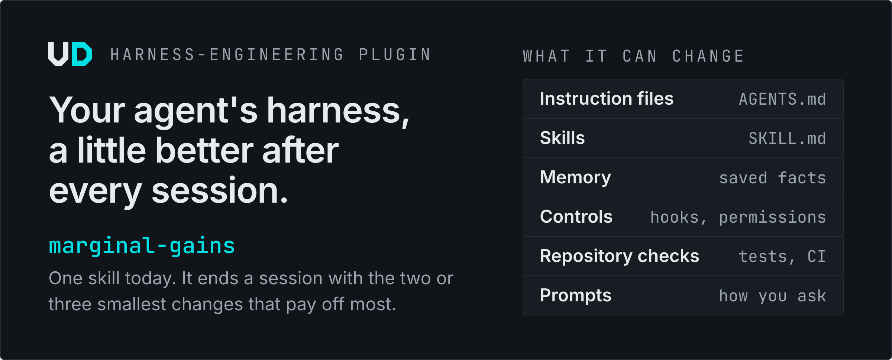
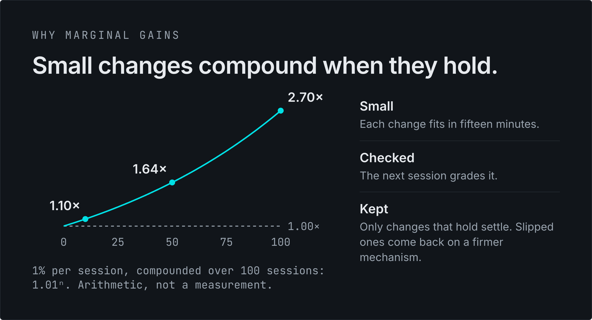

# Harness engineering

<picture>
  <source media="(prefers-color-scheme: dark)" srcset="../../visuals/harness-engineering/1-plugin-dark.png">
  <source media="(prefers-color-scheme: light)" srcset="../../visuals/harness-engineering/1-plugin-light.png">
  
</picture>

Run `marginal-gains` at the end of a session with your coding agent. It reads what actually happened and hands you two or three small changes to your harness, each with the evidence behind it, the exact edit, and a check the next session will show.

## Install

Claude Code:

```bash
claude plugin marketplace add theultimate-dev/skills
claude plugin install harness-engineering@theultimate-dev
```

Codex, Copilot, Cursor, Pi and other agents:

```bash
npx skills add theultimate-dev/skills --skill marginal-gains
```

Then, before you close a session, ask: `Use marginal-gains before we wrap up.` More install routes are [below](#all-install-routes).

<picture>
  <source media="(prefers-color-scheme: dark)" srcset="../../visuals/harness-engineering/2-sessions-dark.png">
  <source media="(prefers-color-scheme: light)" srcset="../../visuals/harness-engineering/2-sessions-light.png">
  
</picture>

<picture>
  <source media="(prefers-color-scheme: dark)" srcset="../../visuals/harness-engineering/3-compound-dark.png">
  <source media="(prefers-color-scheme: light)" srcset="../../visuals/harness-engineering/3-compound-light.png">
  
</picture>

## Why marginal gains

The idea came from a story about a coach. After the Los Angeles Lakers lost in the 1986 playoffs, Pat Riley asked each of his players to get one percent better in five areas, above their career best. The Lakers won the title the next season. Riley tells it in his own words in [this Selling Power interview](https://www.sellingpower.com/3528/the-pat-riley-formula-for-a-winning-sales-plan/), and James Clear describes the [Career Best Effort program](https://jamesclear.com/career-best-effort) behind it.

The name comes from cycling. Dave Brailsford's British Cycling team called its approach marginal gains, and in 2012 he explained it to the [BBC](https://www.bbc.co.uk/sport/olympics/19174302): "if you broke down everything you could think of that goes into riding a bike, and then improved it by 1%, you will get a significant increase when you put them all together."

Something clicked when I read it: the same works for the harness my coding agents run on. Every session shows where it rubs, whether it's a correction, an instruction I had to repeat, or a command that failed twice before it worked. Fix the smallest of those while it's fresh, check next time that the fix held, and keep going. I believe in Kaizen, but there are already skills called Kaizen, and marginal gains carries the same idea just as well.

## What it does

- **Reads the session** for your corrections, instructions you had to repeat, failures and retries, questions the repository could have answered, steps you did by hand, and what went well.
- **Returns two or three cards**, the most crucial first. Each one quotes its evidence, gives the exact change, small enough to apply in fifteen minutes or less, and says what the next session should show if it worked. A card can target an instruction file, a skill, memory, a hook or permission, a repository check, or the way you prompt.
- **Applies only what you pick.** It never commits, pushes or publishes.
- **Keeps a ledger** in a file you choose, outside your repositories. Each run grades the changes you applied against the new session, brings back the ones that slipped with a firmer fix, leaves out what you declined, and ranks friction higher each time it recurs. Your goals, at the top of the ledger, decide which improvements matter most.

It works in any harness that reads `SKILL.md`. Try it with one of these:

```text
Use marginal-gains before we wrap up.

Use marginal-gains on this session. My goals, in order: help my readers
and clients, grow my open-source projects, grow the company.

Use marginal-gains and also read my last five sessions in this project.
```

## All install routes

Pick one route per machine; installing the same skill through two routes gives you two copies.

### Claude Code

```bash
claude plugin marketplace add theultimate-dev/skills
claude plugin install harness-engineering@theultimate-dev
```

Add `--scope project` to the install to share the plugin with everyone working in the current repository. You get the skill as `/harness-engineering:marginal-gains`.

### Copilot CLI

```bash
copilot plugin marketplace add theultimate-dev/skills
copilot plugin install harness-engineering@theultimate-dev
```

### Any agent, with `npx skills`

The [skills CLI](https://github.com/vercel-labs/skills) installs into Claude Code, Codex, Copilot, Grok Build, Pi, Cursor and many other agents. Without `-y` it asks which agents to target.

```bash
# the whole plugin (the repository folder is skills/, hence skills/skills)
npx skills add theultimate-dev/skills/skills/harness-engineering

# every agent on this machine, user scope, no prompts
npx skills add theultimate-dev/skills/skills/harness-engineering -g -a '*' -y

# this skill only
npx skills add theultimate-dev/skills --skill marginal-gains
```

You get the skill by name, `/marginal-gains` or `$marginal-gains` depending on the harness.

### Pin a release

The plugin's releases are tagged `harness-engineering--vX.Y.Z`. In Claude Code, add the marketplace at a marketplace tag, which pins every plugin in it; `v0.2.0` is the release that shipped this plugin's 0.1.0.

```bash
claude plugin marketplace add https://github.com/theultimate-dev/skills.git#v0.2.0
claude plugin install harness-engineering@theultimate-dev
```

With `npx skills`, pin the plugin at its own tag:

```bash
npx skills add theultimate-dev/skills/skills/harness-engineering#harness-engineering--v0.1.0
```

### Other clients

| Client | Install |
|---|---|
| Pi | `pi install git:github.com/theultimate-dev/skills` (every plugin in the repository) |
| APM | `apm install theultimate-dev/skills/skills/harness-engineering/marginal-gains` in a project APM can tell your agent from, such as one with `CLAUDE.md` or `.cursor/`; elsewhere, add `--target claude` or the harness you use |
| Claude.ai, Claude Desktop, Cowork, ChatGPT | Download `marginal-gains-0.1.0.zip` from the [harness-engineering 0.1.0 release](https://github.com/theultimate-dev/skills/releases/tag/harness-engineering--v0.1.0) and upload it in the client's skills settings |

To update or remove the plugin, see [Update](../../README.md#update) and [Remove](../../README.md#remove) in the repository README.

## More

- [Changelog](CHANGELOG.md)
- [Why the harness gets a plugin of its own](../../decisions/0012-harness-engineering-category.md)
- [Every plugin in this repository](../../README.md)
- [MIT license](../../LICENSE)
