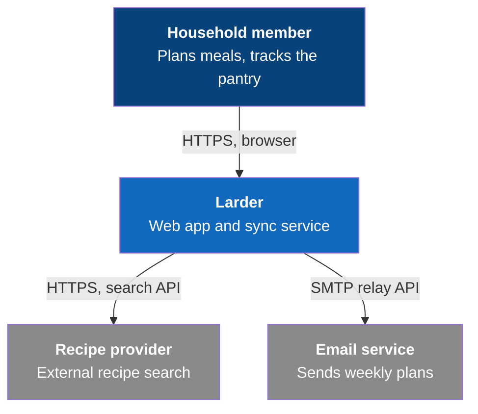
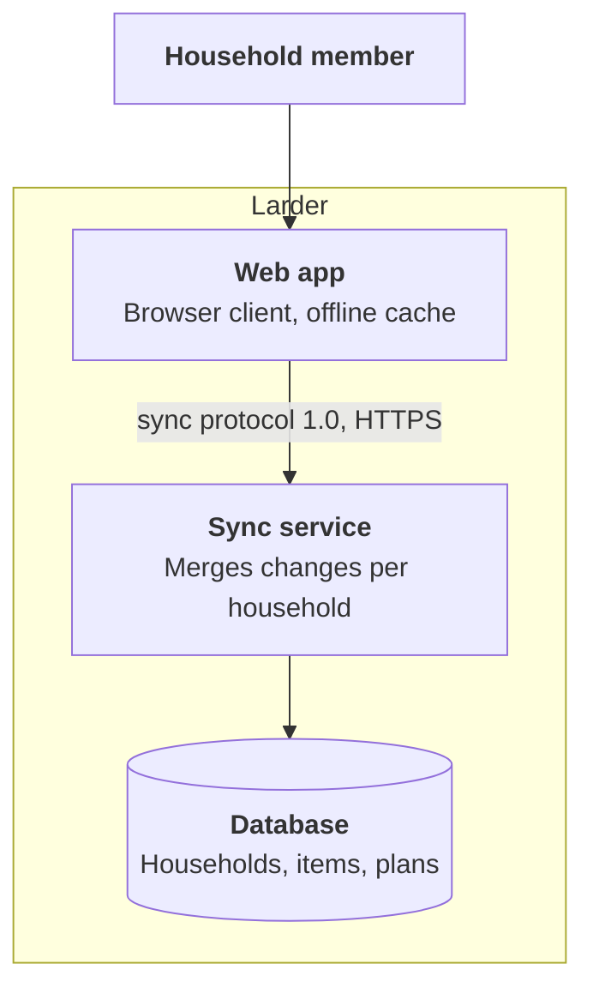

# Views and checklist

How `architecture/` is laid out, how deep each view goes, and how to draw it. The examples use Larder, a fictional household pantry and meal-planning app: a web app, a sync service and a database, in `larder-context`.

## Contents

- arc42 as a checklist
- The tag format
- C4 depth
- Drawing the views
- Runtime scenarios
- The data view
- Cross-cutting concepts

## arc42 as a checklist

arc42 has twelve sections. Use them to check that nothing is missing, not as a document to fill in. Each section has a home in the repository, often outside `architecture/`, or is marked "not needed yet" in `architecture/README.md`.

| arc42 section | Home in the context repository |
|---|---|
| 1. Introduction and goals | `product/overview.md` (vision, principles); the top quality goals as NFR IDs in `architecture/README.md` |
| 2. Constraints | `product/overview.md`, assumptions and constraints; technology constraints as decisions |
| 3. Context and scope | `architecture/context.md` |
| 4. Solution strategy | A short "Strategy" paragraph in `architecture/README.md` that links the decisions behind it |
| 5. Building block view | `architecture/containers.md`, `architecture/components/` |
| 6. Runtime view | `architecture/runtime/` |
| 7. Deployment view | `architecture/deployment.md`, `architecture/build-and-release.md` |
| 8. Cross-cutting concepts | `architecture/concepts/`, `architecture/domain-model.md`, `architecture/data.md` |
| 9. Architecture decisions | `decisions/` |
| 10. Quality requirements | `product/requirements/non-functional.md`; each concept names the NFR IDs it serves |
| 11. Risks and technical debt | The roadmap's risk register, `roadmap/risks.md`; architecture files cite a risk ID in plain text at most, never a link |
| 12. Glossary | `product/glossary.md` |

A section with nothing to say yet is fine. A section nobody checked is not.

## The tag format

Every section heading in `architecture/` carries one line directly under it:

```
## Sync service
Since: V1 · Status: planned
```

- `Since:` is the version in which the element first exists. An element that changes shape in a later version keeps its `Since:` and gains a line such as `Changed in: V2 (shared households)`.
- `Status:` is `planned` until a bet that builds it is `built`, then `built`, set in as-built mode from that bet's evidence. A retired element reads `Status: retired in V3, replaced by …`.
- A file whose sections all share one tag may carry it once under its title.

`architecture/README.md` explains the legend once. An untagged section reads as unverified, so never leave one untagged.

## C4 depth

| Level | File | Content | Depth rule |
|---|---|---|---|
| 1. System context | `context.md` | The product as one box, every person and external system it touches, what flows on each arrow | Complete from the baseline on |
| 2. Containers | `containers.md` | Every separately running or deployable unit and every store, its technology, and the protocol on each arrow | Complete for the versions planned in detail; the next version sketched as `planned` |
| 3. Components | `components/<container>.md` | The parts inside one container and their responsibilities | Only for containers whose inside several bets touch; stop when a bet could pick the structure itself |
| 4. Code | none | Classes, modules, files | Never in the context repository; the code repository is the source |

Most products need levels 1 and 2 only. Level 3 pays for a container that grows over many bets, such as a service holding most of the domain logic.

## Drawing the views

Draw C4 views as Mermaid `flowchart` diagrams. Mermaid's dedicated C4 syntax is still experimental, its layout is hard to control, and it renders differently across viewers; a flowchart with styled nodes renders everywhere.

- One diagram per view. Labels of a few words; the protocol or message family on every arrow.
- Mark external systems and people with classes, and explain the colours once in the text.
- Under the diagram, one or two sentences for what the picture cannot show: which arrow is the riskiest, what never talks to what.

Level 1 for Larder:



Level 2 for Larder:



The sync protocol between the web app and the sync service is the only arrow two bets build from opposite ends, so it is a contract: `architecture/contracts/sync-protocol.md`.

## Runtime scenarios

Group runtime files by topic, not by diagram type. `runtime/sync.md` holds the sync flow, the conflict state machine and the offline-then-reconnect sequence together, because a reader working on sync needs all three.

| Show | Diagram |
|---|---|
| A flow with decisions and loops | `flowchart` with swimlanes as subgraphs |
| Messages between parts in time order | `sequenceDiagram` |
| A lifecycle that screens or services depend on | `stateDiagram-v2` |
| Entities and their relationships | `erDiagram`, in `domain-model.md` |

Write the baseline's runtime scenarios for the main flow, the hardest path (the one where the most can go wrong), and the flows the first milestone's requirements describe. A scenario names the requirement IDs it serves and the contracts its arrows use.

## The data view

`data.md` lists every store, including stores that live outside the product's own containers:

| Store | Holds | Lives in | Kept |
|---|---|---|---|
| Household data | Households, members, pantry items, meal plans | Database | Until the household is deleted |
| Offline cache | The last synced household state | Each browser | Replaced on every sync |
| Change log | Every accepted change, append-only | Database | 90 days, then compacted |

Add a data-flow diagram only when trust boundaries matter: which data crosses which boundary, and what never does.

## Cross-cutting concepts

A concept is a rule several containers obey, written once under `concepts/`:

- Security and trust boundaries: who may call what, where credentials live, what never leaves a boundary.
- Error handling and recovery: what happens on a lost connection, a crash, a partial failure; what the user sees.
- Consistency: how state converges, what is authoritative, how conflicts resolve.
- Identity and access, observability, internationalisation, accessibility rules that shape the structure.

Each concept names the NFR IDs it serves and the containers it binds. Leave out concepts the product does not need; an empty concept file is noise.
