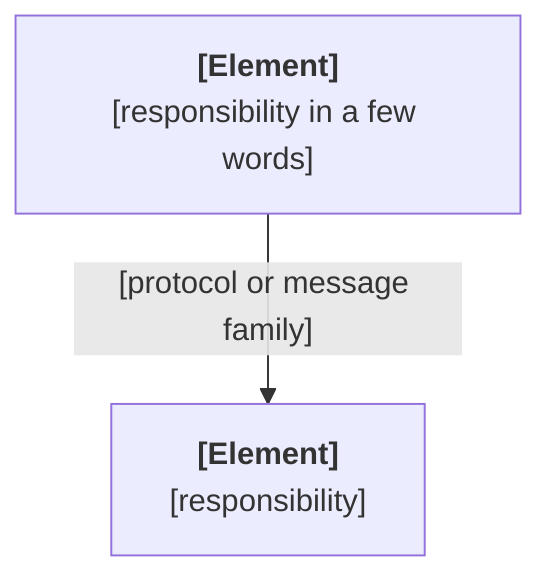

# [View, concept or scenario name]

Since: [V1] · Status: [planned | built]

<!-- One concern per file: a C4 view (context, containers, one container's components), a cross-cutting concept, or one topic's runtime scenarios.
Paths are relative to the repository root, as backticked text. Never describe classes, files or functions; point at the code repository instead.
When sections arrive in different versions, give each section its own Since/Status line and drop the one above. Delete this comment. -->

[Two or three sentences: what this file shows and why it matters. Name the requirement IDs it serves.]

[One or two sentences for what the diagram cannot show: the riskiest arrow, what never talks to what.]

## Elements

| Element | Responsibility | Technology | Since | Status |
|---|---|---|---|---|
| [name] | [one line] | [runtime, store or protocol] | [V1] | [planned] |

## Rules

<!-- For a concept: the rules every element obeys, one per line, each with the NFR IDs it serves. For a view: the constraints that hold across its elements. -->

- [Rule]. Serves: [NFR-NN].

## Related

- Contracts: [`architecture/contracts/name.md`, version X.Y | none]
- Decisions: [`decisions/NNNN-title.md`, … | none]
- Code repository decisions that shaped it: [`<repository>: decisions/NNNN-title.md` | none]
