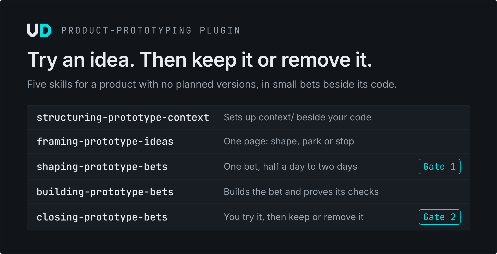

# Product prototyping

<picture>
  <source media="(prefers-color-scheme: dark)" srcset="../../visuals/product-prototyping/1-plugin-dark.png">
  <source media="(prefers-color-scheme: light)" srcset="../../visuals/product-prototyping/1-plugin-light.png">
  
</picture>

For a prototype: a product with no planned versions, where you try an idea and then keep it or remove it. Your agent turns an idea into a bet of half a day to two days, builds it, and proves the result. You decide twice: you approve the bet before work starts, and you keep or remove it after trying it.

## Install

Claude Code:

```bash
claude plugin marketplace add theultimate-dev/skills
claude plugin install product-prototyping@theultimate-dev
```

Codex, Copilot, Cursor, Pi and other agents:

```bash
npx skills add theultimate-dev/skills/skills/product-prototyping
```

Then, in your prototype's repository, ask: `Use structuring-prototype-context to set up context for this prototype.` More install routes are [below](#all-install-routes).

<picture>
  <source media="(prefers-color-scheme: dark)" srcset="../../visuals/product-prototyping/2-loop-dark.png">
  <source media="(prefers-color-scheme: light)" srcset="../../visuals/product-prototyping/2-loop-light.png">
  
</picture>

<picture>
  <source media="(prefers-color-scheme: dark)" srcset="../../visuals/product-prototyping/3-context-dark.png">
  <source media="(prefers-color-scheme: light)" srcset="../../visuals/product-prototyping/3-context-light.png">
  
</picture>

## What it does

- **`structuring-prototype-context` sets up the folder.** It creates `context/` at the root of your code repository, or adopts the READMEs, specs and agent instructions you already have through a map you approve. A decision record names the trigger for moving on to `product-context`.
- **`framing-prototype-ideas` decides whether an idea earns a bet.** It first checks whether a decision, a dropped requirement or an earlier note already settles the idea. Then it compares two or three options, recommends one, says what would make you remove it after a try, and ends with a one-page note and a verdict: shape, park or stop. You can overrule the verdict.
- **`shaping-prototype-bets` sizes one try.** A bet has an observable outcome, an appetite of half a day, one day or two days as a ceiling, requirement changes with reserved IDs, checks that each name how they are proved, no-gos, scope that may be cut, and a keep-or-remove signal. At Gate 1 you approve it and what the agent may do alone: which branch it commits to, whether it commits context, whether it pushes, and whether closing may revert. Building reads the bet at the commit you approved, so later edits cannot change it.
- **`building-prototype-bets` works until the result matches the bet.** It proves each check by its named method on the commit it made and quotes what it saw; reading code never makes a check pass. A reviewer in a fresh context compares the result with the bet. When the appetite runs out, it cuts what the bet marked as cuttable or stops, and only you can raise the appetite. It adds the changelog entry and leaves you the steps to try.
- **`closing-prototype-bets` asks you to keep or remove.** It shows each check with its evidence and what only your eye can judge, and only your explicit words decide. Keep marks the requirements and architecture as built and records the decisions the build settled. Remove reverts exactly the bet's code commits, records its new requirements as dropped with your reason, and writes the lesson. Either way it rebuilds the board and the indexes.

They work in any harness that reads `SKILL.md` and need no other plugin. When installed, `decision-records` and `release-process` from `foundations` keep the decision log and the changelog, and `improving-prompts` from `prompt-engineering` drafts the briefs for workers. Try it with these:

```text
Use structuring-prototype-context to set up context for this prototype.

Use framing-prototype-ideas: should we try a weekly recap email?

Use shaping-prototype-bets to turn that framing into a bet.

Use building-prototype-bets: bet 03 is approved.

Use closing-prototype-bets: I tried bet 03, keep it.
```

## When to use this, and when to use product-context

Both keep the same discipline: requirements with permanent IDs, decisions with reasons, bets with observable checks. They differ in what a product needs around it.

| | `product-prototyping` | `product-context` with `product-engineering` |
|---|---|---|
| The product | No planned versions; ideas are tried, then kept or removed | Long-running, with versions and milestones |
| The context | `context/` in the code repository | A Markdown repository of its own |
| A bet | Half a day to two days of working time | One plan, or two to three, within a milestone |
| Your decisions | Approve the bet; keep or remove it after trying | Gates G1 to G4, then review of the pull requests categorized `human` |
| The code lands | On the branch you name at Gate 1; a removed bet is a revert | In one pull request per slice |
| The requirement catalogue | Only `built` and `dropped` rows; an open bet carries its own changes | Priorities, target versions and statuses |

The recommended trigger for moving on is a planned release or a second contributor, so if either is already true, start with `product-context`. The same goes for a context that must live apart from its code. When the trigger fires later, `structuring-product-context` restructures the folder and a new decision record supersedes the old one.

## All install routes

Pick one route per machine; installing the same skill through two routes gives you two copies.

### Claude Code

```bash
claude plugin marketplace add theultimate-dev/skills
claude plugin install product-prototyping@theultimate-dev
```

Add `--scope project` to the install to share the plugin with everyone working in the current repository. You get the skills as `/product-prototyping:framing-prototype-ideas`, and so on.

### Copilot CLI

```bash
copilot plugin marketplace add theultimate-dev/skills
copilot plugin install product-prototyping@theultimate-dev
```

### Any agent, with `npx skills`

The [skills CLI](https://github.com/vercel-labs/skills) installs into Claude Code, Codex, Copilot, Grok Build, Pi, Cursor and many other agents. Without `-y` it asks which agents to target.

```bash
# the whole plugin (the repository folder is skills/, hence skills/skills)
npx skills add theultimate-dev/skills/skills/product-prototyping

# every agent on this machine, user scope, no prompts
npx skills add theultimate-dev/skills/skills/product-prototyping -g -a '*' -y

# one skill only
npx skills add theultimate-dev/skills --skill framing-prototype-ideas
```

You get each skill by name, `/framing-prototype-ideas` or `$framing-prototype-ideas` depending on the harness.

### Pin a release

The plugin's releases are tagged `product-prototyping--vX.Y.Z`. In Claude Code, add the marketplace at a marketplace tag, which pins every plugin in it; `v0.4.0` is the release that shipped this plugin's 0.1.0.

```bash
claude plugin marketplace add https://github.com/theultimate-dev/skills.git#v0.4.0
claude plugin install product-prototyping@theultimate-dev
```

With `npx skills`, pin the plugin at its own tag:

```bash
npx skills add theultimate-dev/skills/skills/product-prototyping#product-prototyping--v0.1.0
```

### Other clients

| Client | Install |
|---|---|
| Pi | `pi install git:github.com/theultimate-dev/skills` (every plugin in the repository) |
| APM | `apm install theultimate-dev/skills/skills/product-prototyping/<skill>`, once per skill, in a project APM can tell your agent from, such as one with `CLAUDE.md` or `.cursor/`; elsewhere, add `--target claude` or the harness you use |
| Claude.ai, Claude Desktop, Cowork, ChatGPT | From the [product-prototyping 0.1.0 release](https://github.com/theultimate-dev/skills/releases/tag/product-prototyping--v0.1.0), download `structuring-prototype-context-0.1.0.zip`, `framing-prototype-ideas-0.1.0.zip`, `shaping-prototype-bets-0.1.0.zip`, `building-prototype-bets-0.1.0.zip` and `closing-prototype-bets-0.1.0.zip`, and upload each in the client's skills settings. The release's `checksums.txt` verifies them |

To update or remove the plugin, see [Update](../../README.md#update) and [Remove](../../README.md#remove) in the repository README.

## More

- [Changelog](CHANGELOG.md)
- [Why prototypes get a plugin of their own](../../decisions/0020-product-prototyping-category.md)
- [Every plugin in this repository](../../README.md)
- [MIT license](../../LICENSE)
