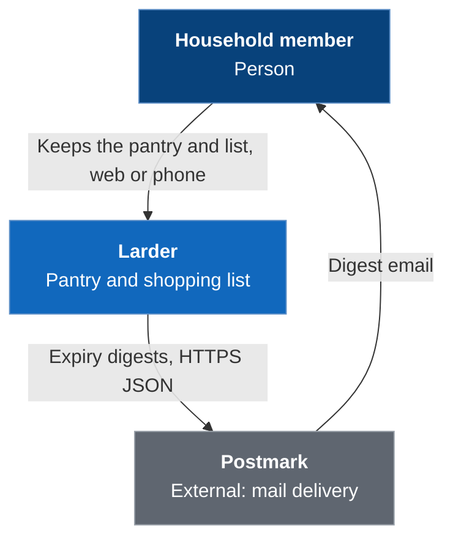
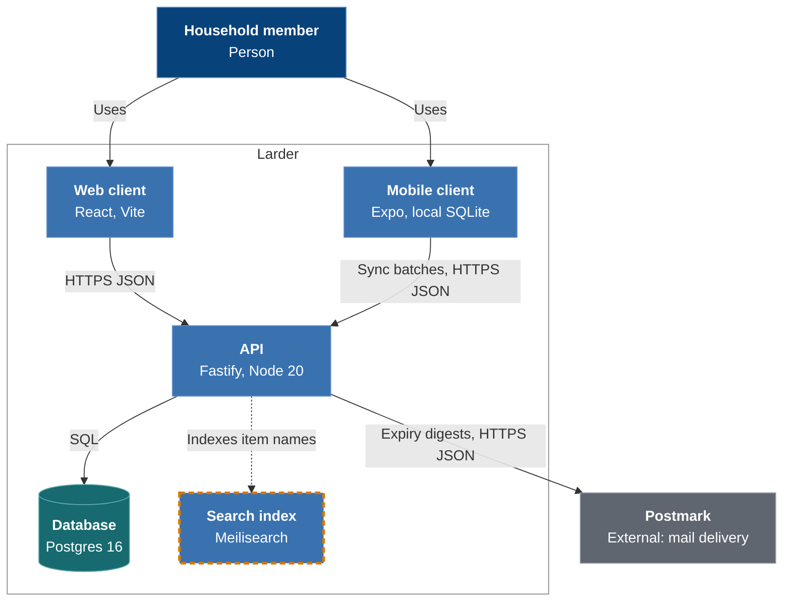
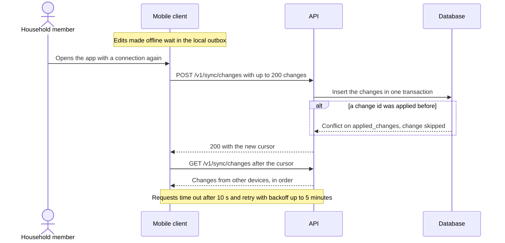
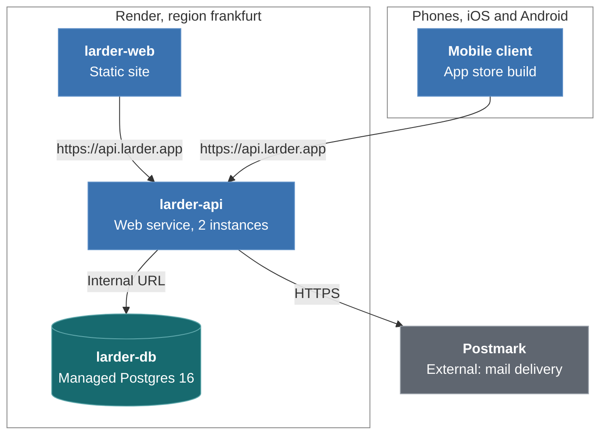
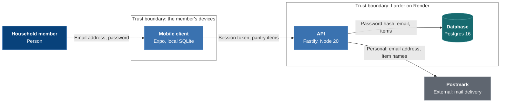
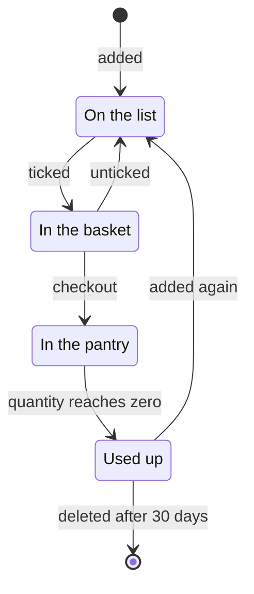
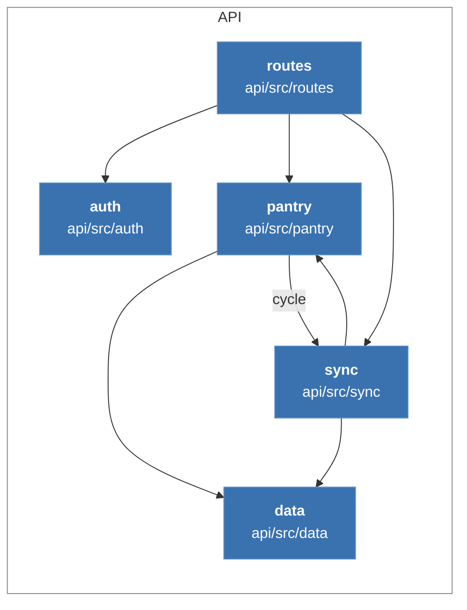
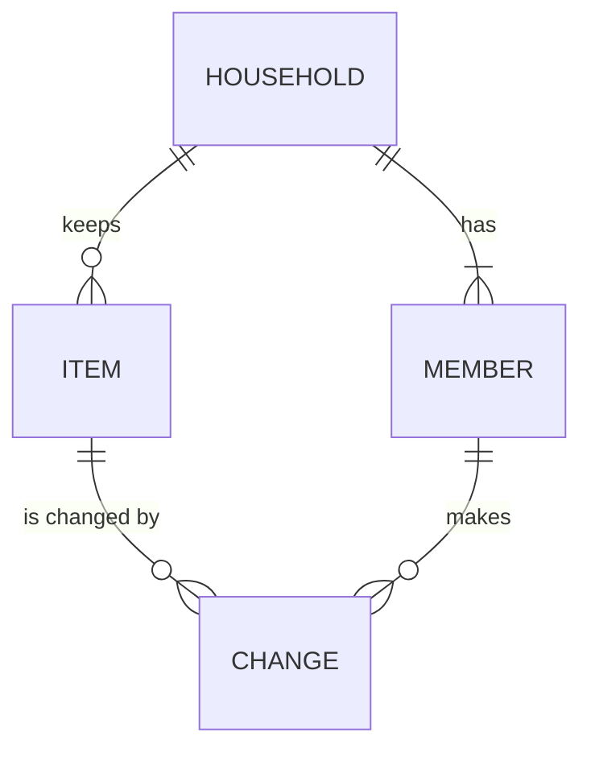
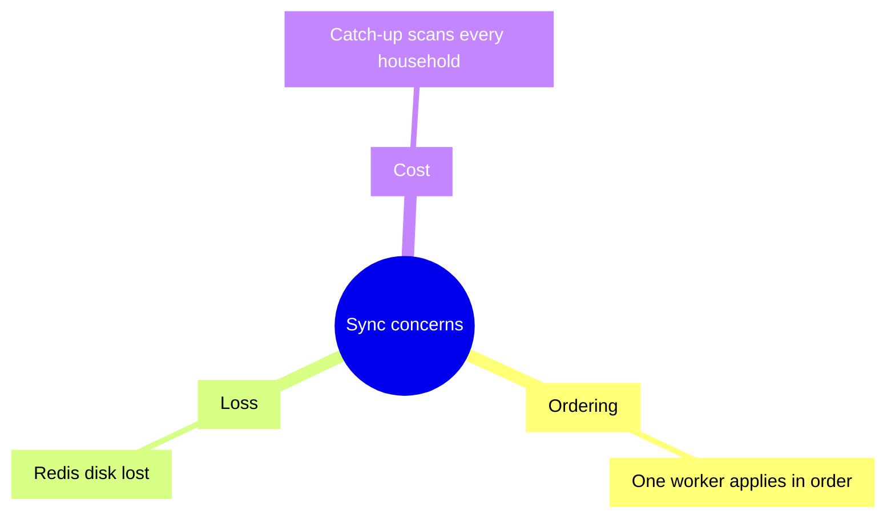
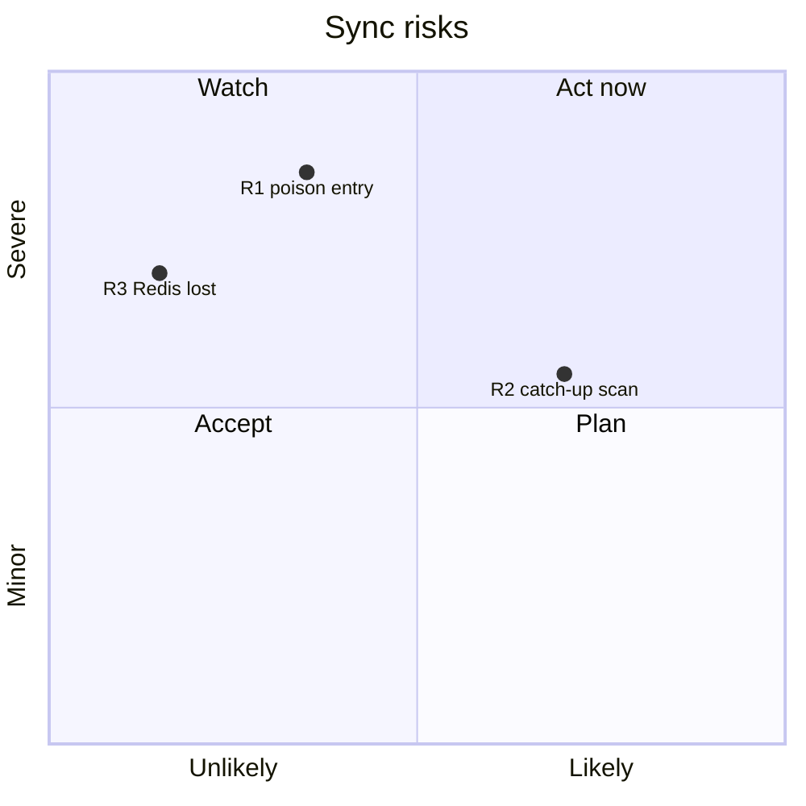

# View conventions

How to place, choose and write architecture views, so that every skill that writes one writes it the same way and one built page can draw them all. The view template, `templates/view.md` in this skill, is the copyable form of these rules; this file gives the reasons.

The examples use Larder, a fictional household pantry app: a web client, a mobile client, an API and one Postgres database, with Postmark for mail.

## Contents

1. [Where the work lives](#where-the-work-lives)
2. [Choosing the view](#choosing-the-view)
3. [The view file](#the-view-file)
4. [Status and the Verified line](#status-and-the-verified-line)
5. [Element ids](#element-ids)
6. [Evidence](#evidence)
7. [Mermaid](#mermaid)
8. [Worked examples](#worked-examples)
9. [Size and splitting](#size-and-splitting)
10. [In place of a board](#in-place-of-a-board)
11. [Links between views](#links-between-views)
12. [Before you finish](#before-you-finish)

## Where the work lives

### The location rule

Read the repository's `AGENTS.md`, or its `CLAUDE.md` when there is no `AGENTS.md`, and follow any file either one imports. Where they point to an architecture folder and a decision log, use those two folders. Where they point nowhere, use `context/architecture/` and `context/decisions/` at the repository root, and propose one pointer line for the root `AGENTS.md` in your report, for example:

```
- Architecture: `context/architecture/` (views and studies; open `architecture.html` to see them drawn). Decisions: `context/decisions/`.
```

Propose the line rather than writing it, because `AGENTS.md` is the person's file and every agent reads it. Once the line is there, the next agent finds the folder without guessing.

The architecture folder is the one folder this format writes into. Every path called a source path below is relative to it.

### Nothing is committed

Write files; never commit them. The person reviews the views and studies and commits them, because a view is a claim about their system and they answer for it. Say in your report which files you wrote or changed, so they can review exactly those.

### The tree

When you create the folder yourself, it holds:

```
context/architecture/
├── README.md            the index: every standing view and study, by link, with status
├── architecture.html    the built page that draws every view
├── context.md           standing views, one per file, only the ones that help
├── containers.md
├── runtime-<topic>.md
└── studies/
    └── YYYY-MM-DD-<slug>/
        ├── README.md    the study: a risk review, an options study, a simplification study or a guide
        └── <view>.md    views that belong to this study only
```

Create only the views that answer a question someone has asked. An empty or speculative view costs a reader time and drifts first.

File names are lowercase kebab-case and say what the view shows: `context.md`, `containers.md`, `runtime-<topic>.md`, `deployment.md` (or `deployment-<environment>.md` when there are several), `data-flow-<topic>.md`, `states-<thing>.md`, `modules-<container>.md`. A study's slug names its subject in two to four words: `2026-11-10-sync-risks`. A study's view is named after the standing view it varies, then the variant: `containers-household-feed.md`, `containers-before.md`, `containers-after.md`.

### The index

`README.md` in the architecture folder lists every standing view and every study, by link, with its status. Copy it from the index template of the skill that builds the page, or, without that template, write: one line on how to read the folder and open the page; a table of standing views (link, question it answers, status, verified); a table of studies (date, link, kind, outcome); a table of element ids; where the decision log is. Update the index in the same change as the view or study, because the page and the next agent find files through it.

### Standing views and studies

A standing view describes the system: what is built, and what is accepted but not built yet. A study is a dated piece of thinking: a risk review, an options study, a simplification study, or a guide that explains existing views to one audience.

A study never edits a standing view. It writes its own views inside its folder. When the person accepts a study's outcome, the standing views are updated as a separate step, with the changed elements marked `planned`, and the study stays unchanged as the record of why. Keeping the two apart means a standing view never shows something nobody agreed to, and a study still reads as it did on its date.

A study's `README.md` starts with its title and one line the index can be built from:

```
# Risk review: offline sync

Date: 2026-11-10 · Kind: risk review · Outcome: findings shown, one change proposed
```

Kind is one of `risk review`, `options study`, `simplification study`, `guide`. Outcome is a few words: `findings shown`, `waiting for the pick`, `picked option B on 2026-11-12`, `accepted`, `narrowed`, `declined`, `written`. Update the Outcome when the person answers, and the index row with it.

A simplification study keeps a copy of each standing view it changes, as `<view>-before.md`, beside its `<view>-after.md`. The standing view will change once the outcome is accepted, and the study must still show what it compared. Other studies compare against the standing view directly.

### Inside a context that already exists

| Found | What to do |
|---|---|
| A prototype context: `context/AGENTS.md` describes a context folder with `architecture/` and `decisions/` | Its `architecture/` is the architecture folder and its `decisions/` the decision log. Follow its map and its index rules; its statuses are `built` and `planned`, the same as here. Write standing views in this format: it is that context's view shape with the Id and Evidence columns, the Relationships table and the Verified part added, so its other readers still find the title, the Status line, the diagram and the Elements table where they expect them. Keep any section its existing views carry that this format lacks, such as Rules, and leave its existing views as they are unless you are changing them for another reason. Put studies in `architecture/studies/`, written in this format, and list them in its architecture index as its rules allow, or in a Studies table at the end when they have no place for them. Build the page there only when the context's own rules allow that one built file; otherwise say the page was not built and why |
| A product context repository: a separate repository with `architecture/` at its root, named by `AGENTS.md` or by the person | Write no standing view there: that repository has its own process for its architecture. Write the study in the code repository's architecture folder, by the location rule, and say in your report that it is input for that repository's architecture work |
| An existing architecture folder, such as `docs/architecture/`, that `AGENTS.md` points to | Use it and keep its file names. Add `studies/` and the page beside its files. Add `README.md` from the index template when it has no index; when it has one, add the standing-view and study tables to it and keep the rest. Write new views in this format; bring an existing file into the format only when you change it for another reason |
| Nothing | Create the tree above and propose the pointer line |

## Choosing the view

### The view sentence

Before drawing, write one sentence:

> This view helps *audience* answer *question* about *scope* in *state*.

For example: "This view helps a new engineer answer which application or store carries each responsibility about Larder as built." State is one of: as built, as planned, as proposed in this study. When you cannot fill the sentence, the question is not clear yet: ask the person, or say what you assumed. The sentence becomes the first sentence of the view, so every reader knows what the picture is for and what it leaves out on purpose.

### Pick the level, then the concern

Pick the highest level that shows the fact in question: outside dependencies need the context, responsibilities inside the system need the containers, the inside of one container needs its modules. Then pick the concern from the seven defaults:

| Question | View | Mermaid type | File |
|---|---|---|---|
| Who uses it, and what does it depend on outside? | Context | `flowchart TB` | `context.md` |
| Which applications and stores carry which responsibility? | Containers | `flowchart TB` with the system as a subgraph | `containers.md` |
| What happens in what order, with timeouts and retries? | Sequence | `sequenceDiagram` | `runtime-<topic>.md` |
| Where does it run, and what fails together? | Deployment | `flowchart TB` with nested subgraphs | `deployment.md` |
| Where does sensitive data go, across which trust boundaries? | Data flow | `flowchart LR` with trust boundaries as subgraphs | `data-flow-<topic>.md` |
| Which states are allowed? | State machine | `stateDiagram-v2` | `states-<thing>.md` |
| What depends on what, and where are the cycles? | Module graph | `flowchart LR` | `modules-<container>.md` |

Draw one view first. Draw a second only for a question the first leaves open, and write that question as the second view's sentence. A full set of views by default costs every reader time and gives drift more places to start.

When a question asks which information a store owns, an `erDiagram` beside the containers or data-flow view answers it; see the worked example.

## The view file

One view per Markdown file, in this order, as the view template lays it out:

1. `# System: view name`, for example `# Larder: containers`.
2. The Status line: `Status: built · Verified: 2026-11-17 at a1b2c3d`.
3. Two or three sentences: the view sentence, then what the picture shows at what level.
4. One fenced `mermaid` block.
5. One or two sentences for what the picture cannot show: order, timing, a condition, the riskiest arrow, what never talks to what. A diagram looks complete; this sentence tells the reader where it is not.
6. `## Elements`: a table with the columns Id, Element, Responsibility, Technology, Status, Evidence. One row per node in the diagram, in the order the diagram declares them. A subgraph is not a row: the system it stands for has its row in the context view, and a deployment node or trust boundary is named in the prose. For a person the Technology cell says `Person`; for an external system it names the interface you use, such as `HTTPS JSON API`.
7. `## Relationships`: a table with the columns From, To, What flows, Evidence. From and To are element ids. One row per arrow, so every arrow has its evidence; in a sequence view, one row per message the question turns on.
8. `## Related`: relative links to other views, studies and decision records, each list labelled.

The tables hold what the picture cannot: the full responsibility, the version, the evidence. Keep the diagram's labels short and put the detail in the tables, so the picture stays readable and every fact has one place.

In a sequence view, the Elements table lists the participants, and the Relationships table lists the messages the question turns on. In a state machine view, the Elements table lists the elements that hold the state and that change it, and the Relationships table lists the calls that trigger transitions. In a module graph, each module is an element.

## Status and the Verified line

**Status values.** An element is `built` when the code has it, `planned` when the person accepted it and it is not built yet, `proposed` when a study suggests it and nobody has accepted it. Standing views use only `built` and `planned`; `proposed` appears only in a view inside a study. This keeps standing views to what is true or agreed.

**The view's Status.** The line is `Status:` and one value, followed by the Verified part only when it applies; without a check it is just `Status: built`. The value is `built` when every element and relationship in the view is built. `planned` when at least one is planned. `proposed` when at least one is proposed, which only happens inside a study. The Status column of the Elements table says which elements carry which status.

**Verified.** The Verified part, `· Verified: YYYY-MM-DD at <short commit>`, says that on that date every built element and relationship in the view was checked against the code at that commit. Write it only when you have just done that check: each built element and relationship has evidence that exists at that commit and shows what the row says, and nothing inside the view's scope is missing from the picture. Take the commit from the repository's current commit, abbreviated to seven characters, such as the output of `git rev-parse --short HEAD` where a shell is available. When files you checked have uncommitted changes, leave Verified off and say why, because a commit that does not contain what you checked makes the line false.

When you change a built element or relationship without checking it against the code, delete the Verified part, with its separating dot. A reader trusts that line more than anything else in the file; a stale one is worse than none. Planned and proposed elements are not checked against the code, so they neither need nor break the Verified line.

When a planned element is built, mark it `built` only after checking it against the code, and then write a fresh Verified part if the whole view was checked.

## Element ids

Every element has one id, and that id is its Mermaid node id in every view and study, and its value in the Id, From and To columns. Risks, option matrices and notes refer to elements by id. One id per element lets a risk found in one study point at the same box another study proposes to remove, and makes a rename one search.

**Choosing an id.** A short lowercase noun from the element's own name: `member`, `web`, `mobile`, `api`, `db`, `postmark`. Use only lowercase ASCII letters, digits and underscores, starting with a letter; join two words with an underscore: `household_feed`. Hyphens and spaces break some diagram types. Avoid words Mermaid reads as keywords, which fail to parse or draw the wrong thing: `end`, `class`, `classDef`, `style`, `linkStyle`, `click`, `subgraph`, `graph`, `flowchart`, `direction`, `loop`, `alt`, `opt`, `par`, `critical`, `break`, `rect`, `note`, `participant`, `actor`, `state`. Add a word instead: `end_user`, `note_service`.

**A module's id** starts with its container's id: `api_sync`, `api_pantry`. A deployment node that runs one container keeps that container's id; a node that only hosts others gets its own: `render`, `phones`.

**Before you choose a new id**, look it up in the index's element ids table and search the architecture folder for it, where a shell is available. Reuse the existing id when the element is the same; choose a new one when it is not.

**Ids never change. An existing view's Mermaid node ids are its elements' ids even when no table lists them: before you choose an id, read the diagrams of the views already in the folder, reuse what you find, and add those ids to the index's table.** When an element is renamed in the code, change its label and Element cell and keep the id. When an element is split, the parts get new ids and the old id stays with the part that keeps its main responsibility. When an element is removed, its id is not reused, so an old study still means what it meant.

## Evidence

Each row of the Elements and Relationships tables has an Evidence cell that says why the row is believed:

- **A repository path**, backticked, relative to the repository root: `` `api/src/sync/stream.ts` ``. Add a line, `` `api/src/sync/stream.ts:18` ``, when one statement in a long file proves the row. Line numbers move when the file changes, so give the whole file when the file as a whole is the evidence. Separate several paths with commas.
- **A statement**: `stated by <person>, <YYYY-MM-DD>`, for what only a person can know: a runtime setting, a plan, an agreement with a vendor.
- **Neither**: write `assumed`. An assumed row is an honest gap that the next check can close; a row with invented evidence hides one.

Evidence paths point at code, configuration, infrastructure and schema files, so they are relative to the repository root, unlike links between views, which are relative to the file they sit in. For a planned element, the evidence is what made it planned: the decision record's path, or `stated by`. For a proposed element, the evidence is the study's own README, or `assumed`.

## Mermaid

### The subset

Use only these diagram types, at Mermaid 12.3.0: `flowchart`, `sequenceDiagram`, `stateDiagram-v2`, `erDiagram`, `mindmap`, `quadrantChart`. They draw on GitHub, in common Markdown editors and in the built page, so the source stays readable wherever the folder is opened. C4 views (context, containers, deployment) are flowcharts with styled nodes; Mermaid's own C4 and architecture diagram types overlap labels and boxes at ordinary sizes.

Write no `%%{init}%%` directive, no front-matter config, no `style` lines, no `linkStyle` lines and no `click` lines. The page and GitHub choose the theme and layout; a directive in one view makes it draw unlike the others, a per-node `style` bypasses the palette, a `linkStyle` breaks when an arrow is added above it, and GitHub ignores clicks. `%%` comment lines are fine.

### Quoting

Quote a label wherever the diagram type takes a quoted string, because a quoted label can hold parentheses, colons, commas and HTML that would otherwise break the parse:

| Diagram type | Quote | Leave bare |
|---|---|---|
| `flowchart` | Node labels `api["..."]`, edge labels `-->\|"..."\|`, subgraph titles `subgraph render["..."]` | ids |
| `stateDiagram-v2` | State descriptions `state "In the pantry" as in_pantry` | Transition labels after the colon |
| `erDiagram` | Relationship labels `: "owns"` | Entity names |
| `mindmap` | Node text in its shape `order["Ordering"]` | ids |
| `quadrantChart` | Axis labels, quadrant labels, point names | The `title` |
| `sequenceDiagram` | nothing | Participant names, messages, notes |

Sequence text, state transition labels and a quadrant chart's title stay bare because Mermaid draws their quotes literally. Bare text must not contain `;` or `#`: the semicolon ends the statement and the hash starts an entity code. Write "then" for a semicolon and "number 42" for "#42". Inside a quoted label, write a double quote as `#quot;`.

### The label form

A flowchart node label is the element's name in bold, a line break, and one short line:

```
api["<b>API</b><br/>Fastify, Node 20"]
```

The second line is the technology for a container or store, `Person` for a person, and `External: <what it provides>` for an external system. Keep it under about six words; the full responsibility goes in the Elements table. Use only the tags `<b>` and `<br/>`: GitHub draws both, and the page does too. A store is a cylinder, `db[("<b>Database</b><br/>Postgres 16")]`; every other element is a rectangle.

An arrow points from the element that starts the interaction to the one it calls or writes to, even when data comes back, so arrows read the same way in every view. An edge label says what flows and, where it matters, the protocol: `-->|"Sync batches, HTTPS JSON"|`. Use a solid arrow `-->` for a built relationship and a dotted arrow `-.->` for a planned or proposed one, because the line style shows status without colour.

### The palette

Every flowchart ends with this block of `classDef` lines, copied whole, followed by `class` lines that give each node its kind and, where it applies, its status:

```
  classDef person fill:#08427b,stroke:#5d8fc7,color:#ffffff
  classDef system fill:#1168bd,stroke:#5d8fc7,color:#ffffff
  classDef container fill:#3a72b0,stroke:#5d8fc7,color:#ffffff
  classDef store fill:#176a6f,stroke:#5fa8ac,color:#ffffff
  classDef external fill:#5f6670,stroke:#9aa1aa,color:#ffffff
  classDef boundary fill:none,stroke:#8a8a8a,stroke-width:1px
  classDef planned stroke:#d97706,stroke-width:3px,stroke-dasharray:6 4
  classDef proposed stroke:#c026d3,stroke-width:3px,stroke-dasharray:3 3
```

| Class | Give it to | Shows as |
|---|---|---|
| `person` | a person or role | dark blue |
| `system` | the system as one box, in a context view | blue |
| `container` | an application, service, job or module | mid blue |
| `store` | a database, stream, queue or file store | teal cylinder |
| `external` | a system someone else runs | grey |
| `boundary` | a subgraph: the system's boundary, a deployment node, a trust boundary | thin grey outline, no fill |
| `planned` | a planned element, as a second class | amber dashed border |
| `proposed` | a proposed element, as a second class | magenta dotted border |

Give each node one kind class, and a status class on a second line when it is planned or proposed; the status classes come after the kind classes in the block, so their border wins:

```
  class web,mobile,api container
  class db store
  class search container
  class search planned
```

The styles live in the view so the same source draws the same way on GitHub, in an editor and in the built page. Every fill carries white text at a contrast of at least 4.9 to 1, and the status borders contrast at least 3 to 1 with both a white and a dark page, so the picture reads in light and dark themes. Copy the block whole, even lines the view does not use, so every view carries the same palette and a later edit only adds `class` lines. A sequence, state, ER, mindmap or quadrant view takes no palette: mark a planned or proposed participant by adding `(planned)` or `(proposed)` to its name.

## Worked examples

Each example draws with Mermaid 12.3.0. Adapt the content, keep the form.

### Context



### Containers

The system is a subgraph with the system's id, so the context view's box opens into this one. People and external systems stay outside it.



### Sequence

Show one scenario, with its alternative paths, timeouts and retries. Notes carry what arrows cannot.



### Deployment

Subgraphs are the places things run; nested subgraphs show what fails together. A node that runs one container keeps that container's id.



### Data flow

Trust boundaries are subgraphs titled with who controls them. Each arrow names the data, and the label says when it is personal or secret.



### State machine

State ids are local to the one lifecycle, so they follow the id characters but are not element ids. Name the element that holds the state in the view sentence.



### Module graph

Modules sit inside their container's subgraph. Every arrow means "imports", so the view sentence says so once and arrows stay unlabelled, except the ones that close a cycle.



### Information a store owns

Concepts and how they relate, at most about eight, with no columns: column detail is data modelling and changes with every migration. Name the store that owns them in the view sentence.



## Size and splitting

Keep a view to 12 elements, 15 at most. Count every node: people, systems, containers, stores, external systems, modules; a subgraph does not count. In a sequence, count participants. Past that size every layout engine tangles, and the same source is laid out differently on GitHub, in editors and in the page, so a small view is the only kind that reads well everywhere.

Split a larger system in one of two ways:

- **By level.** The context view shows the system as one box; the containers view opens it; a module graph opens one container. Each view links to the one it zooms out of and into.
- **By concern.** Two container views, each with the elements one question needs: `containers-sync.md` for the sync path, `containers-notifications.md` for mail. An element that appears in both keeps its id and class in both.

When a view needs an element only as the far end of one arrow, keep it as one node and say in the Elements table that it is detailed in another view.

## In place of a board

A board with freely placed sticky notes looks flexible, but its positions carry no meaning a reader can check and it does not diff. Use these forms instead:

| You want to show | Use | Why |
|---|---|---|
| Options against criteria | A Markdown table: one row per scenario or constraint, one column per option, a sentence in each cell | A sentence says why; a score hides it. A table diffs line by line |
| Clusters of ideas or concerns | A `mindmap`, or a `flowchart` with one subgraph per cluster | The grouping is explicit in the source |
| Forces, such as likelihood against impact | A `quadrantChart` with labels of three words at most, starting with an id | Labels sit on their points, so long ones overlap; the detail goes in a list below |
| Before and after | Two views with the same ids, compared side by side in the page through a compare link | The reader sees both at once, and every unchanged element is the same box |

An options table:

```
| Scenario or constraint | A: household feed | B: partition the stream | C: index the stream |
|---|---|---|---|
| S1: 7-day catch-up under 10 s | Reads one household only, so it holds at any size | Holds, but only after a migration of every cursor | Holds up to about 50,000 changes a day |
| One developer on call | One more stream to watch | Several workers to watch | Nothing new to run |
```

A mindmap of clusters:



A quadrant chart of forces:



Keep points at least 0.1 apart on both axes, so their labels do not overlap.

## Links between views

Links between views, studies and the index are ordinary relative Markdown links to the `.md` file, so they work on GitHub and in any editor, and the page turns each link to a file it holds into a switch to that view. From a standing view or the index, link by file name; from a study, a standing view is two folders up, so the link target starts with two parent-folder steps (each is two dots and a slash) before the file name. A link to a decision record is relative from the view's folder to the record in the decision log.

```
- Views: [containers.md](containers.md) opens the Larder box.
- Studies: [2026-11-10-sync-risks](studies/2026-11-10-sync-risks/README.md).
```

**Opening the page on one view or a comparison.** The page opens on one view with `architecture.html#view=` and a source path, and on two views side by side with `architecture.html#compare=` and two source paths separated by a comma. A source path is the file's path relative to the architecture folder, with forward slashes and its `.md` ending, wherever the link sits. From the index or a standing view:

```
[Compare the current containers with the household feed](architecture.html#compare=containers.md,studies/2026-11-10-sync-risks/containers-household-feed.md)
[Open the containers view](architecture.html#view=containers.md)
```

From a study, the link target reaches the page two folders up, with the same two parent-folder steps before `architecture.html`, while the source paths after `=` stay relative to the architecture folder. Put the standing or before view first and the changed view second, so every comparison reads left to right as before and after.

## Before you finish

- The view sentence is the first sentence, and the view answers that one question.
- The file has the eight parts in order; the Elements table has one row per node, and every From and To is an element id.
- Every id already used elsewhere in the folder means the same element here; new ids are in the index's element ids table.
- Every Evidence cell is a path, a `stated by`, or `assumed`.
- Status is `built` or `planned` on a standing view, and `proposed` appears only under `studies/`. Verified is there only if you checked the view against the code just now.
- The diagram is one of the six types, labels are quoted as the quoting table says, flowcharts end with the whole palette block and `class` lines, and the view has at most 15 elements.
- The index lists the view or study, and links resolve.
- The built page is rebuilt as your skill's instructions say, or your report says it is out of date.
