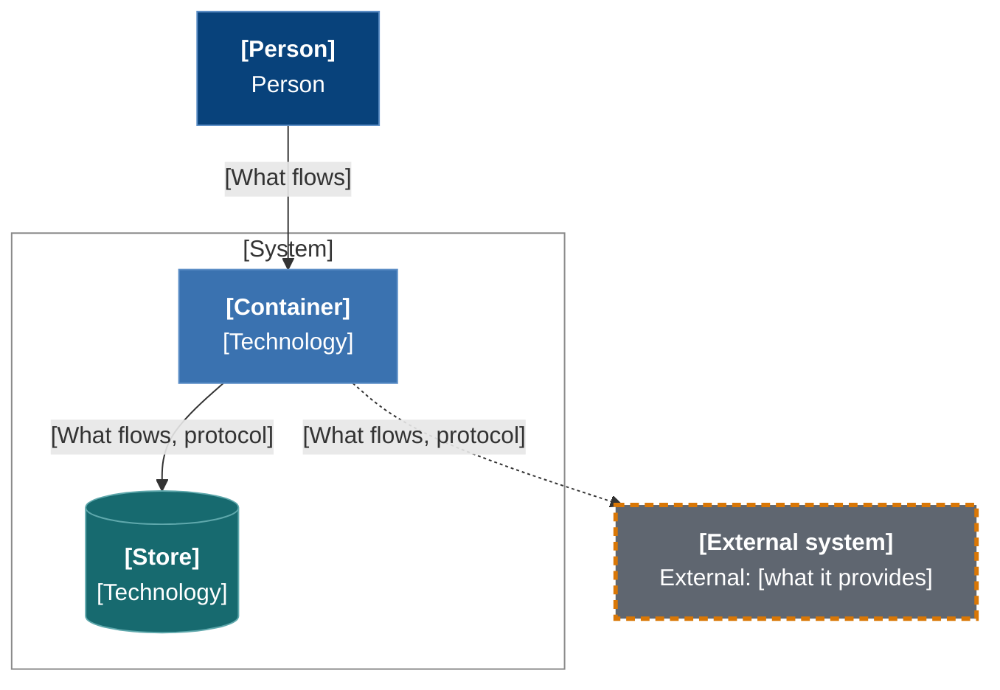

# [System]: [view name]

Status: [built | planned | proposed] · Verified: [YYYY-MM-DD] at [short commit]

<!-- One view per file, written as the view conventions reference in this skill describes. Copy this file into the architecture folder and name it after the view: context.md, containers.md, runtime-[topic].md.
Status is built when every element is built; planned when at least one element is planned; proposed only in a view inside a study. Keep the Verified part only when you checked every built element and relationship against the code at that commit just now; otherwise delete it, with its separating dot, and leave the Status alone.
The first sentence below is the view sentence. Node ids are the element ids: reuse the id an element already has in every other view and study. Copy the classDef lines whole, even the ones this view does not use, and give each node its class lines. A planned or proposed relationship is a dotted arrow.
Evidence is a backticked path from the repository root, optionally with :line, or "stated by [person], [YYYY-MM-DD]", or the word assumed. Links in Related are ordinary relative Markdown links to the .md files. Delete this comment. -->

This view helps [audience] answer "[question]" about [scope] [as built | as planned | as proposed in this study]. [One or two sentences: what the picture shows at what level, and the one fact to take from it.]

[One or two sentences for what the picture cannot show: order, timing, a condition, the riskiest arrow, what never talks to what.]

## Elements

| Id | Element | Responsibility | Technology | Status | Evidence |
|---|---|---|---|---|---|
| [id] | [name as drawn] | [one line] | [runtime, framework, store or protocol] | [built] | [`path/from/repository/root.ext:line`] |

## Relationships

| From | To | What flows | Evidence |
|---|---|---|---|
| [id] | [id] | [data, calls or messages, and the protocol] | [`path/from/repository/root.ext:line`] |

## Related

- Views: [relative links to the views this one zooms out of, zooms into or sits beside | none]
- Studies: [relative links to the studies that examined this view | none]
- Decisions: [relative links to the decision records that shaped it | none]
