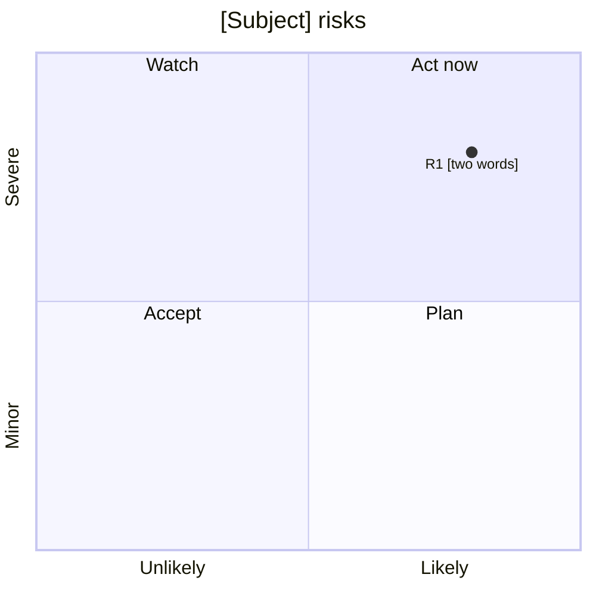

# Risk review: [subject]

Date: [YYYY-MM-DD] · Kind: risk review · Outcome: [findings shown | no architecture change needed | a few words]

<!-- Save as studies/[YYYY-MM-DD]-[slug]/README.md in the architecture folder; the slug names the subject in two to four words.
Keep the title and the header line first: the index row is copied from them. Update the Outcome when the person answers, and the index row with it.
The Intake comes directly under the header line: put no summary or finding above it; the headline finding goes in "Does this need an architecture change?". Ids: S scenarios, C constraints, F facts, A assumptions, P proposals, R risks, T trade-off points. Element ids are the ids of the views.
Links to standing views and to the page start with two parent-folder steps, because the study sits two folders below the architecture folder; the source paths after "#compare=" stay relative to the architecture folder.
Write "none" under a heading that has nothing, with what was checked. Delete this comment and every unused placeholder. -->

## Intake

Asked by [person] on [YYYY-MM-DD]: "[their words]"

**The real question.** [One or two sentences, without the solution the person named.]

**Priority scenarios.**

| Id | Source | Stimulus | Environment | Part affected | Response | Measure |
|---|---|---|---|---|---|---|
| S1 | [who or what] | [what happens] | [conditions] | [element ids] | [what the system does] | [number or observable condition] |

Considered, not traced: [scenarios left out, one phrase each, or none].

**Hard constraints.**

- C1: [constraint]. Evidence: [path, stated by, or decision record link].

**Facts.**

- F1: [fact]. Evidence: [`path:line` or stated by].

**Assumptions.**

- A1: [assumption]. Confirmed by: [observation or person].

**Proposals.**

- P1: [the named solution or design under review, or none]. Source: [the person's words, a study view, a document].

**Already decided.**

- [link to a decision record, an accepted study or a standing view]: [what it settles here, or "the decision log is empty"].

## Scope

Views read: [links to the standing views and earlier studies read]. Code read at commit [short commit]: [the folders and files the traces crossed]. Earlier reviews of this subject: [which of their findings still hold, changed or were wrong, or none].

## Scenario verdicts

| Scenario | Verdict | Reasoning | Evidence |
|---|---|---|---|
| S1 | [met \| at risk \| unknown] | [one or two sentences: the mechanism that carries it, or the path on which it fails, or what is missing and the next action] | [`path:line`, risk ids] |

### S1 trace

| Step | Element | What it does | Mechanism | Evidence | Measure after this step |
|---|---|---|---|---|---|
| 1 | [id] | [what it does with the stimulus] | [timeout, retry, transaction, order, limit] | [`path:line`] | [budget spent, or what still holds] |

Sensitivity points: [settings whose small change moves this scenario sharply, with evidence, or none].

## What the scenarios miss

### Single points of failure

| Element or place | If it stops | Scenarios that fail | Noticed by | Recovery | Risk |
|---|---|---|---|---|---|
| [id, or the host, disk, region, key or person] | [what stops] | [S ids] | [alert, user report, nobody] | [automatic in seconds, manual in hours] | [R id, or accepted and why] |

### Dependencies slow, down, wrong, duplicated, out of order

| Dependency | Slow | Down | Wrong answer | Duplicate | Out of order |
|---|---|---|---|---|---|
| [caller → dependency] | [what happens] | [what happens] | [what happens] | [what happens] | [what happens] |

### Trust boundaries and sensitive data

| Data | From → to | Boundary crossed | Guarded by | Finding |
|---|---|---|---|---|
| [credentials, tokens, personal data, secrets] | [id → id] | [the boundary] | [authentication, encryption, nothing] | [R id, or none] |

[One sentence on what this pass did not cover, and whether a security specialist should look further.]

### Premortem

A year from now this failed. Stories from [the lenses used], each checked against the evidence:

1. [Lens]: [trigger → mechanism → consequence, through element ids]. [Kept as R id | kept as assumption A id | ruled out by `path`].

## Risks

Ranked by likelihood and impact; irreversible harm ranks above reversible harm of the same bands.

| Rank | Id | Elements | Cause | Consequence | Evidence | Likelihood | Impact | Change kind |
|---|---|---|---|---|---|---|---|---|
| 1 | R1 | [ids] | [condition and mechanism] | [scenario or promise that breaks, what is seen] | [`path:line` or assumed] | [likely \| possible \| unlikely]: [basis] | [severe \| major \| minor]: [basis] | [architecture \| inside one element \| operational \| accept] |

Top risks: [R ids, usually three to five].

<!-- Optional: a quadrant chart of the risks, points at the band centres (0.2, 0.5, 0.8), labels an id and two words, title bare, other labels quoted. Delete when unused. -->

## Trade-off points

- T1: [mechanism or setting] helps [S id] because [reason] and hurts [S id] because [reason]. Evidence: [`path:line`]. Choosing between them is the person's call.

## Next checks

| Risk | Check | Settled when | Where it runs |
|---|---|---|---|
| R1 | [the cheapest observation that confirms or clears it] | [the threshold, both ways] | [a copy, a test environment, production read-only, a person] |

## Does this need an architecture change?

[One plain sentence: which findings need an architecture change, or "No: [reasons tied to the scenarios]". Then, for each top risk, the kind of change it needs and where.]

## Views

- Annotated view: [a relative link to `[view]-risks.md` in this folder]. [A compare link whose target is the page two folders up, then `#compare=[view].md,studies/[YYYY-MM-DD]-[slug]/[view]-risks.md`, with the standing view first.]
- Failure sequence: [a relative link to `runtime-[topic]-[failure].md` in this folder], [what it shows]. Or: Order adds nothing here, because [reason].

## What this review assumed

- [Element, relationship or runtime fact taken without evidence, and what would confirm it.]

## Views that disagree with the code

- [Standing view and row, what the code shows instead, with `path:line`; or none found on the traced paths.] These are reported, not changed.

## Not covered

[What lies outside the review's scope: paths not traced, environments not examined, and that this is not a full security assessment.]

## Next

[The skill that fits next and why: exploring-architecture-options for an architecture change with more than one way to make it, simplifying-system-architecture for mechanisms that carry no scenario, recovering-built-architecture for views without evidence or at odds with the code, a decision record for an accepted finding. Or: no architecture change; run the next checks.]
